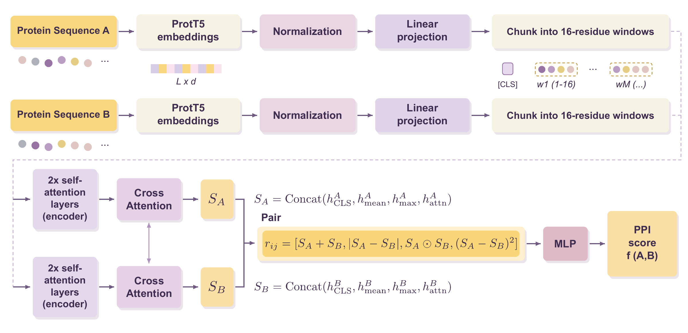
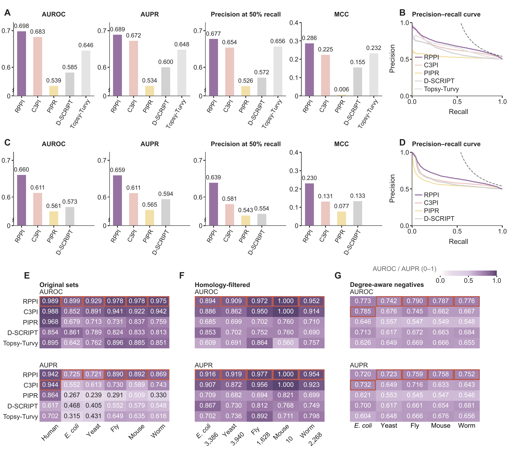
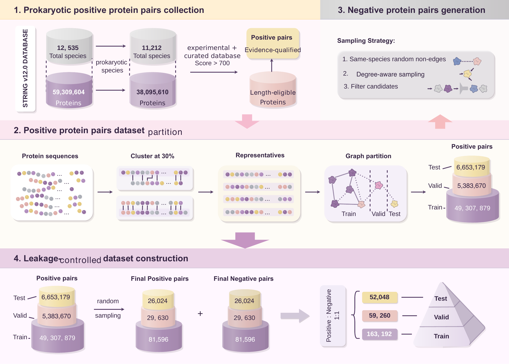

# RPPI

**RPPI (Reciprocal Protein Pair Inference)** is a sequence-based model for predicting protein–protein interactions. It combines ProtT5 residue embeddings, reciprocal cross-attention and symmetric scoring to produce interaction scores that are independent of input order.

This repository contains the model implementation, training and prediction scripts, evaluation configurations, and a small runnable example. The default example uses the prokaryotic-trained checkpoint; full benchmark datasets and model weights are hosted in the companion Hugging Face repositories.

- Code: [Monica-Gao/rppi](https://github.com/Monica-Gao/rppi)
- Model weights: [Monica-Gao/rppi-models](https://huggingface.co/Monica-Gao/rppi-models)
- Datasets: [Monica-Gao/prokppi-bench](https://huggingface.co/datasets/Monica-Gao/prokppi-bench)

All three repositories are currently private. Download the current files from the default branch (`main`).

## Installation

Clone the repository using an authorized GitHub account, then use Python 3.12 in a dedicated environment:

```bash
git clone git@github.com:Monica-Gao/rppi.git
cd rppi
python3.12 -m venv .venv
source .venv/bin/activate
python -m pip install -e ".[embeddings]"
```

The workflow has been tested on Linux with Python 3.12.13, PyTorch 2.7.1, NumPy 2.5.4, SciPy 1.18.1, scikit-learn 1.5.2 and PyYAML 6.0.3. The embedding extra installs Transformers 4.44.2, tokenizers 0.19.1, SentencePiece 0.2.0, huggingface-hub 0.25.2 and protobuf 5.28.3. Use the appropriate PyTorch build for CPU or CUDA; the quickstart runs on CPU. Dependencies are declared in `pyproject.toml`.

## Quickstart: prokaryotic interaction prediction

Run these commands from the repository root. The bundled `examples/quickstart/` contains twelve real prokaryotic protein sequences and six pairs from ProkPPI-Bench: one positive and one sampled negative pair from each training, validation and test split. The small example checks the workflow; use the full test set for benchmark evaluation. Source paths and checksums are recorded in `examples/quickstart/source.json`.

First download the prokaryotic checkpoint and the pinned upstream ProtT5 model. While the model repository is private, log in with an authorized Hugging Face account:

```bash
huggingface-cli login
huggingface-cli download Monica-Gao/rppi-models \
  --include "rppi-prokaryotic/*" \
  --local-dir models/rppi-models
python scripts/download_prott5.py --output-dir models/prot_t5_xl_uniref50
```

ProtT5 is a separate download of approximately 11.3 GB. An existing matching ProtT5 directory can be reused. Generate the embeddings and predict the two held-out example pairs:

```bash
python scripts/generate_prott5_embeddings.py \
  --fasta examples/quickstart/sequences.fasta \
  --model-dir models/prot_t5_xl_uniref50 \
  --output-dir runs/quickstart/embeddings \
  --device cpu
rppi predict \
  --model-dir models/rppi-models/rppi-prokaryotic \
  --pairs examples/quickstart/test.tsv \
  --embeddings runs/quickstart/embeddings \
  --output runs/quickstart/predictions.tsv \
  --device cpu
```

Use a new embedding output directory for each run, or reuse the generated arrays when predicting again. To evaluate the example with a threshold selected on its validation pairs:

```bash
python scripts/configure_paths.py \
  --template configs/release/rppi-prokaryotic.yaml \
  --data-dir examples/quickstart \
  --embeddings runs/quickstart/embeddings \
  --run-dir runs/quickstart/training \
  --output runs/quickstart/config.yaml
python scripts/evaluate_checkpoint.py \
  --config runs/quickstart/config.yaml \
  --checkpoint models/rppi-models/rppi-prokaryotic/rppi-prokaryotic.pt \
  --output-dir runs/quickstart/evaluation \
  --select-threshold-on-valid --device cpu
```

## Predicting your own pairs

Replace the example FASTA and pair file in the commands above. Pair files contain two tab-separated protein IDs and an optional binary label, with an optional `proteinA`, `proteinB`, `label` header. IDs must match the FASTA headers.

The embedding generator maps U/Z/O/B to X, retains up to 900 residues and saves one float16 `L × 1024` NumPy array per protein. The predictor pads or truncates to the checkpoint's configured input length. Outputs include both ordered logits and `sigmoid((logit_ab + logit_ba) / 2)`; `--threshold` optionally adds binary predictions.

## Training and benchmark evaluation

Download the full prokaryotic benchmark:

```bash
huggingface-cli download Monica-Gao/prokppi-bench --repo-type dataset \
  --include "releases/prokppi-bench/*" \
  --local-dir data/prokppi-bench
```

Generate embeddings from its `sequences.fasta` using the same embedding command, then configure paths for the full splits:

```bash
python scripts/configure_paths.py \
  --template configs/release/rppi-prokaryotic.yaml \
  --data-dir data/prokppi-bench/releases/prokppi-bench \
  --embeddings /path/to/full-benchmark-embeddings \
  --run-dir runs/prokaryotic \
  --output runs/prokaryotic.yaml
python scripts/train.py --config runs/prokaryotic.yaml
python scripts/evaluate_checkpoint.py \
  --config runs/prokaryotic.yaml \
  --checkpoint models/rppi-models/rppi-prokaryotic/rppi-prokaryotic.pt \
  --output-dir runs/prokaryotic-evaluation \
  --select-threshold-on-valid
```

The training command trains a new model; the evaluation command above evaluates the released checkpoint. Both accept `--device auto|cpu|cuda` and `--threads`.

## Other evaluation settings

The Bernett human benchmark is available from its [official Figshare release](https://doi.org/10.6084/m9.figshare.21591618.v3) (CC BY 4.0). A copy in RPPI input format is provided in the [companion dataset repository](https://huggingface.co/datasets/Monica-Gao/prokppi-bench#bernett-human-benchmark) for convenience.

Human-benchmark and cross-species transfer configurations are under `configs/release/`. Figures 3E and 3F use `rppi-human-transfer`; Figure 3F changes the target test subset. Figure 3G uses ten independently trained models, two reciprocal directions for each of five target species, and reports the unweighted mean of the two directional metrics per species. Checkpoint hashes, epochs and data mappings are in `model_registry.json`.

For these settings, select the matching template and dataset directory with `configure_paths.py`. Use `--test-embeddings` when target embeddings are stored separately from human embeddings.

## Model overview

RPPI represents each protein in the context of its partner through reciprocal cross-attention. The final interaction score combines both input orientations through symmetric inference.



*Figure 2. Model architecture.*

## Performance

RPPI achieved the highest AUROC and AUPR among the directly comparable sequence-based predictors evaluated on both the Bernett human benchmark and ProkPPI-Bench. It also showed strong cross-species transfer under the original, homology-filtered and degree-aware evaluation settings, leading AUROC in four of the five target species in the degree-aware setting.



*Figure 3. Benchmark performance and cross-species transfer. Panels A-D compare the human and prokaryotic benchmarks; panels E-G show the three transfer settings. Panel G reports the mean of the two reciprocal partition directions for each species.*

## ProkPPI-Bench

ProkPPI-Bench provides a sequence-separated benchmark for prokaryotic protein interaction prediction. Global sequence partitioning and within-species negative sampling produce 274,500 balanced protein pairs across bacterial and archaeal species. The released training, validation and test sets are available in the [companion dataset repository](https://huggingface.co/datasets/Monica-Gao/prokppi-bench).



*Figure 1. Construction of ProkPPI-Bench.*

## Repository contents

- `rppi/`: model, data, loss, metric and inference modules.
- `scripts/`: embedding generation, training, inference and evaluation commands.
- `configs/release/`: benchmark and transfer configurations.
- `examples/quickstart/`: small prokaryotic inputs and provenance.
- `tests/`: inference and input-validation tests; run `python -m pip install -e ".[test]"` followed by `python -m pytest -q`.

The code uses the MIT license. Full datasets, checkpoint weights, ProtT5 files and generated embeddings are stored outside the code repository.
